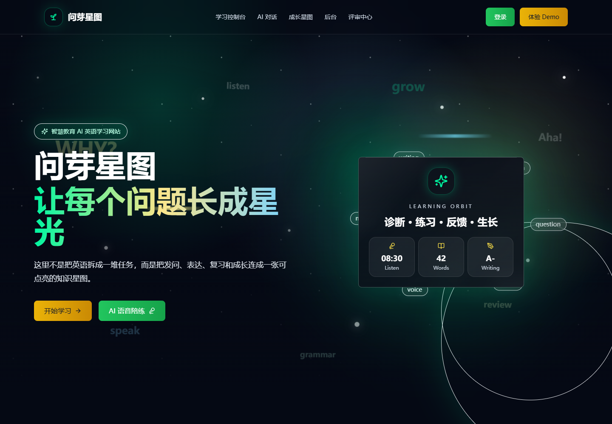

# 问芽星图 · WenYa StarMap

**让一次英语练习，成为可回看的成长路径。** 项目把英语对话、写作练习、单词复习和成长星图放在同一学习界面中；源码还包含课程、后台管理和支付服务接口。

[在线项目导览](https://yangwei251003.github.io/wenya-starmap/) · [MIT](LICENSE) · [第三方说明](THIRD_PARTY_NOTICES.md)



## 当前状态与体验范围

项目开发中。GitHub Pages 发布的是可静态浏览的项目导览，提供功能说明、真实画面与运行入口。完整 Next.js 应用包含 API、认证和数据库，需要自己部署 Node.js 与 Supabase；Pages 不运行这些服务。本轮没有验证既有 Vercel 域名的服务状态，不把历史部署记录当作当前可用承诺。

本轮在保留可回滚快照后，完成 Next.js15.5.28 / React19.2.9 迁移，配套类型与界面/测试库同步适配，现有152测试和生产构建再次通过；最终依赖审计为0项。完整云服务的账号、RLS、模型与支付仍需独立配置和验收。

## 功能与技术栈

| 模块 | 实现与边界 |
|---|---|
| 学习界面 | Next.js 15 / React 19 / TypeScript，Tailwind CSS、Framer Motion、Recharts |
| 成长与复习 | 星图、学习记录、SRS/FSRS 相关调度与服务；效果取决于实际输入和使用，不宣称提高成绩已被实证 |
| AI 对话与语音 | 服务端文本模型请求、Realtime 会话与语音转写接口；需要使用者自己的模型配置，语音还需浏览器权限 |
| 数据与后台 | Supabase Auth/Postgres/RLS，独立管理员配置，数据库迁移随代码保留 |
| 课程与交易 | Stripe Checkout/Webhook 相关源码；本轮不连接真实支付账户、不发起交易 |

## 快速开始

准备 Node.js 24 LTS、npm 与一个由你管理的 Supabase 项目。以下命令在仓库根目录执行：

```bash
git clone https://github.com/yangwei251003/wenya-starmap.git
cd wenya-starmap
npm ci
```

将 `.env.example` 复制为 `.env.local`（PowerShell：`Copy-Item .env.example .env.local`；macOS/Linux：`cp .env.example .env.local`）。所有示例凭证都必须替换为自己的配置。

1. 在 Supabase 的 SQL Editor 按文件编号执行 `supabase/migrations/001` 至 `004` 开头的迁移；先在独立测试数据库评估迁移。
2. 配置 `NEXT_PUBLIC_SUPABASE_URL`、`NEXT_PUBLIC_SUPABASE_ANON_KEY` 和仅服务端使用的 `SUPABASE_SERVICE_ROLE_KEY`。`ADMIN_EMAILS` 填自己的管理员邮箱，不公开私人配置。
3. 文本 AI 配置 `OPENROUTER_API_KEY`；Realtime/转写配置 `OPENAI_API_KEY`。模型名和端点以源码与 `docs/ai/API-CONFIGURATION.md` 为准，并核实自己的服务权限。
4. 仅需支付开发时，使用自己的 Stripe **测试模式**设置；不要将真实账户资料写入代码或 README。

```bash
npm run dev
# 打开 http://localhost:3000
```

生产方式为 `npm run build` 后 `npm start`，或部署到支持 Next.js 服务端的托管环境。先完成下面的框架安全迁移与后端验证；静态导出无法承载所有 API。

## 源码导航

```text
app/                 页面与服务端 API
components/          学习、语音、星空与通用组件
lib/                 复习、数据、模型、权限与错误处理
supabase/migrations/ 数据库结构与权限迁移
docs/                AI、部署、技术与比赛说明
docs/site/           独立静态项目导览与真实截图
video-production/    从本地保留的独立影片制作源码（不属于网站依赖）
```

`video-production` 的基础无声影片没有在本地引用位置找到，因而目前是待补齐的制作档案，不能直接渲染成品；已找到的制作代码和音频生成脚本予以保留，音频成品同样未在引用位置找到。运行状态见该目录 README，不可据此删除本地项目。

## 本轮验证、变更与计划

2026-10-26：在独立副本安装依赖，整合本地已存在的语音转写、Realtime、移动学习/成长星图等 10 个运行源文件；不复制私人环境文件。16 个 Jest 套件、152 个现有测试通过，Next.js 生产构建和类型检查通过（43 个页面/路由条目）。为两处学习总结的查询参数读取补充 Suspense，解决新版同主框架的构建门禁。

首页已使用实际生产服务在无账号、无环境凭证情况下打开并截图；桌面与 390px 手机尺寸未出现页面横向溢出，未观察到页面异常或 HTTP 失败。这个检查没有登录、调用模型、授予麦克风权限、修改数据库或支付，不能代替上述服务的完整验收。

最终 `npm audit` 为0项；针对原 Next14 公告进行了维护分支迁移，未通过忽略公告或关闭类型检查绕过验收。迁移包括两处 `React.JSX.Element` 类型调整、两处查询参数 Suspense，以及将原复习属性测试中不支持最小值的 `fc.nat` 改为符合原意的 `fc.integer({ min: 1, max: 30 })`。[官方Next15迁移说明](https://nextjs.org/docs/app/guides/upgrading/version-15)与项目检查共同确定兼容范围。

后续：持续跟进依赖公告；用独立测试数据库完成登录、RLS、学习记录与语音的集成验收；补齐并复现影片素材。第三方和历史设计文档中的完成声明不等于本轮实测结论。
